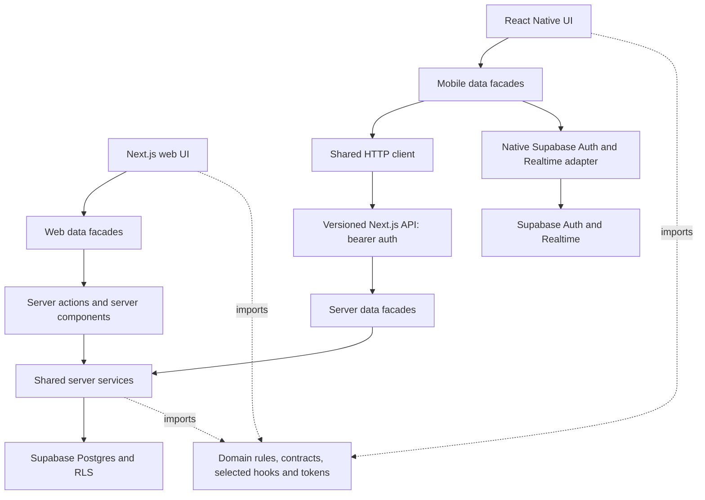

# MoMo on React Native

Research and migration proposal · 2026-09-24 · repository baseline: `5f80279`

This document explains how to add an iOS and Android app while reusing MoMo's existing business behavior, database, and backend. It is a proposal grounded in the current checkout and official platform documentation. It does not implement the migration, change the database, or claim that a native build has been tested.

**Delivery update — 2026-09-25:** follow the [incremental mobile roadmap](mobile-roadmap.md) for implementation order and release gates. It prioritizes the existing Next.js backend for speed, tests shared React Native/React Native Web primitives early, and adopts them through small web releases. It supersedes the original default of separate platform UI implementations and broad upfront package extraction. The findings below remain background research; proposed snippets/layouts are not prerequisites to complete before the first mobile slice.

## 1. Recommendation

Build the mobile app with **React Native and Expo**, keep the existing Next.js web app, and organize both in a **pnpm workspace monorepo**. Extract business rules and contracts into small npm-compatible packages as features need them. Prove shared primitives using React Native Web before expanding UI migration; keep browser/native interactions and application shells separate where needed.

Use the same Supabase project for web and mobile within each environment. Mobile should own its Supabase Auth session and Realtime connection. Initially, route application reads and business mutations through a versioned HTTP API hosted by the existing Next.js deployment. Both that API and existing web server actions should call the same extracted server services.

The important distinction is between two forms of reuse:

- **Shared execution:** both apps execute the same parsing utilities, contracts, state reconciliation, formatting, and chart-data transformations where useful.
- **Shared backend behavior:** both apps invoke the same authoritative expense processing, category learning, household operations, and AI orchestration. That code is reused without shipping it to the phone.

Moving all of `src/lib` or all React components into a shared package would not achieve this. Much of it depends on Next.js cookies, server actions, browser APIs, or DOM rendering.

Assumptions for this proposal: web remains supported; mobile targets iOS and Android; existing personal/household semantics remain authoritative; the first release works online with reconnect recovery. Offline expense creation, push notifications, receipt capture, and a replacement web renderer require separate product scope. These are planning assumptions, not established product decisions.

React Native recommends a framework for new applications; Expo supplies the native development and bundling foundation needed here. Use development builds for native auth and device testing. [React Native guidance](https://reactnative.dev/docs/environment-setup), [Expo development builds](https://docs.expo.dev/develop/development-builds/introduction/).

## 2. What the repository actually contains

The manifest currently specifies Next.js `16.0.10`, React/React DOM `19.2.0`, pnpm `10.28.0`, Supabase JS `^2.81.1`, Supabase SSR `^0.7.0`, and TypeScript `^5`. These are manifest declarations, not a recommendation to copy those versions into Expo. The repository already has `pnpm-workspace.yaml`, but it only lists allowed build dependencies; it does not yet declare application/package workspaces.

Evidence: [package.json](../package.json), [workspace configuration](../pnpm-workspace.yaml), [TypeScript aliases](../tsconfig.json), [Next configuration](../next.config.ts).

### Existing foundations worth preserving

| Foundation | Current evidence | Implication for mobile |
| --- | --- | --- |
| Eight domain facades | [`src/lib/data`](../src/lib/data/README.md): auth, prefs, profile, households, invites, expenses, stats, messages | Preserve the UI/data boundary; change the implementation behind it. |
| Mostly deterministic expense interpretation | [`expense-parser.ts`](../src/lib/helpers/expenses/expense-parser.ts), [`expense-category.ts`](../src/lib/helpers/expenses/expense-category.ts), constants and tests | Good initial shared package; server remains authoritative. |
| Stable message vocabulary | [`chat.ts`](../src/lib/types/chat.ts) | Share statuses, authorship, cursor, and result types. |
| Chat reconciliation/state | [`use-chat-state.ts`](../src/features/chat/hooks/use-chat-state.ts), [`use-household-messages.ts`](../src/features/chat/hooks/use-household-messages.ts) | Extract ordering and reconciliation into pure functions; share selected hooks afterward. |
| Query helpers already accepting a client | [`chat-messages.ts`](../src/lib/helpers/chat/chat-messages.ts), [`expense-fetch.ts`](../src/lib/helpers/expenses/expense-fetch.ts), stats readers | Useful starting pattern for dependency injection. |
| Existing SQL ownership and household model | [`supabase/migrations`](../supabase/migrations), [database documentation](../docs/database.md) | Reuse one schema and migration history; verify policies before exposing new flows. |
| English/Spanish catalogs | [`en.json`](../messages/en.json), [`es.json`](../messages/es.json) | Reuse messages; replace the Next-specific locale integration. |
| Theme definitions | [`themes.config.ts`](../src/lib/theme/themes.config.ts), [`types.ts`](../src/lib/theme/types.ts) | Reuse theme identity and semantics after resolving CSS-only values. |

### Important discrepancies and constraints

1. **The client facades are not transport-independent yet.** Most import `@actions/*`. Messages also use relative `/api/*` URLs. A React Native app cannot import those functions as ordinary mobile code. See [messages client](../src/lib/data/messages/client.ts) and [stats client](../src/lib/data/stats/client.ts).
2. **Authentication is broader than the older docs describe.** [Auth docs](../docs/auth-and-households.md) describe Google-only login, but [login actions](../src/lib/actions/login.ts) also implement password signup/login and a server-configured demo login. Preserve actual supported behavior when defining mobile parity.
3. **Processing is synchronous today.** [sendChatMessage](../src/lib/actions/chat-messages.ts) awaits the processor. The processor's comment suggesting asynchronous execution is stale. Preserve [ADR-001](../docs/adr/001-synchronous-chat-processing.md) behavior during extraction.
4. **Personal chat and personal stats mean different things.** Personal chat requires `household_id IS NULL`; [personal stats rollups](../src/lib/helpers/expenses-stats/personal-rollup.ts) filter by the current user's ID without excluding their household expenses. A shared generic “personal scope” filter would change results.
5. **Auth callbacks do application work.** The [web callback](../src/app/auth/callback/route.ts) ensures a profile, consumes an invite cookie, joins a household, and updates onboarding. Native Supabase login alone does none of that application orchestration.
6. **Mobile will not be protected by the Next proxy.** The [proxy matcher](../src/proxy.ts) excludes API routes. Every HTTP endpoint needs its own authentication and authorization.
7. **Some documented scaffolding is absent.** `CONTEXT.md` and `implementations/decouple-data-layer/migrated-ui-scopes.json` were not present in this checkout. The boundary checker returns an empty migrated-scope list when that JSON is missing. Do not copy a potentially ineffective check into the monorepo unchanged.

The relevant historical decisions remain [shared Realtime](../docs/adr/002-single-shared-realtime-client.md), [cursor sync fallback](../docs/adr/006-cursor-based-sync-fallback.md), and [plain-text AI streaming](../docs/adr/007-momo-streaming-transport.md). Migration work should add explicit updates or new ADRs where behavior changes.

## 3. Reuse map: move, refactor, or rebuild

“High reuse” below means the implementation is structurally suitable for sharing. It is not a measured percentage of the app. A credible percentage requires the first native slice and a defined denominator; lines moved are not a useful product metric.

| Area | Reuse assessment | Required work | Destination |
| --- | --- | --- | --- |
| Domain records, currencies, categories, error codes | High | Replace app aliases; separate domain records from transport types | `@momo/domain` |
| Amount/text parsing, n-grams, stop words, category scoring | High | Move with fixtures; retain COP whole-unit behavior and income handling | `@momo/domain/expenses` |
| Currency formatting | High | Preserve existing currency-specific locale defaults; test native `Intl` output | `@momo/domain/money` |
| Mention parsing and assistant idempotency-key construction | High | Move functions/tests without importing agent runtime | `@momo/domain/chat` |
| Stats builders, month windows, aggregation | High after separation | Separate SQL reads from transformations; preserve income exclusions and personal rollups | `@momo/domain/stats` |
| Existing facade input/result types | Medium | Remove `FormData`, Supabase clients, PostgREST errors, and channels from portable interfaces; retain existing web signatures through adapters | `@momo/contracts` |
| Chat ordering, optimistic matching, cursor comparison | High after extraction | Pure functions with explicit time/ID inputs where needed; retain timestamp/ID ordering | `@momo/domain/chat` |
| `useChatState`, `useHouseholdMessages`, `useMonthlyWindows` | Medium/high | Replace app imports, keep React as peer dependency, separate environment effects | `@momo/react` |
| Composer | Partial | Share draft/send state; keep HTML keyboard/form events on web and native submit callbacks on mobile | Shared hook plus app wrappers |
| Realtime subscription helpers | Medium/high | Inject an authenticated client; normalize events and expose disposal rather than raw channels | `@momo/data-client/realtime` |
| Realtime/sync hooks | Medium | Replace `document.visibilityState`, provider coupling, and fixed facade imports with lifecycle/data ports | Shared coordinator plus app lifecycle adapters |
| `useChatPanel` | Partial | Separate orchestration from dialog controller, visibility listeners, composer events, and native view concerns | `@momo/react` plus app composition |
| `useMomoStream` | Medium/high | Inject the stream function; preserve abort and persisted-message reconciliation | `@momo/react` |
| Server actions and processing | Backend reuse | Extract services accepting authenticated context; retain cookies/redirects/revalidation in web adapters | `@momo/server` |
| AI SDK, model credentials, executors, traces, evals | Backend reuse only | Keep server-only; pass the authenticated context throughout | `@momo/server/agent` and server eval tooling |
| Translation catalogs | High | Share data with compatible interpolation/rich-text formatting adapters | `@momo/messages` |
| Theme tokens | Partial | Resolve `oklch`, `color-mix`, CSS variables, units, and fallbacks to native-supported values | `@momo/tokens` |
| `src/ui`, feature components, charts | Low unchanged-code reuse; shared implementations possible after porting | Prove shared primitives through React Native Web; keep native screens/renderers where necessary | `@momo/ui`, app adapters and components |
| DOM virtualization, media queries, hover, observers | Rebuild | Native lists, layout measurements, accessibility, keyboard/safe-area behavior | Mobile app |
| Next routing, RSC pages, proxy, cookies, metadata | Web-only | Build Expo Router navigation from equivalent policy | Web/mobile app layers |
| SQL migrations/views/RPCs | High | Keep centralized; add only explicit auth, recovery, or idempotency migrations | Root `supabase/` |

Specific browser-bound examples: [`use-chat-virtual.ts`](../src/features/chat/hooks/use-chat-virtual.ts) uses `HTMLElement` and scroll geometry; [`use-composer.ts`](../src/features/chat/hooks/use-composer.ts) consumes HTML events; [`use-chat-panel.ts`](../src/features/chat/hooks/use-chat-panel.ts) imports a web dialog controller; [`resolve-palette.ts`](../src/lib/theme/resolve-palette.ts) returns CSS `color-mix()` expressions. Their filenames alone do not establish portability.

## 4. Target architecture



The mobile app's Supabase connection is real and direct: it signs in, persists/refreshes sessions, and subscribes to changes. HTTP application calls carry the same user's access token to the backend. Backend queries execute with that user's identity so RLS still applies.

Retain the repository's boundary rule in the new app roots: route handlers under `apps/web/src/app` call server data facades, which own authentication/service composition. Native screens and providers call native data facades. Neither kind of UI entrypoint reaches directly into Supabase factories or server packages.

### Why this boundary

| Approach | Advantage | Cost for this repository | Decision |
| --- | --- | --- | --- |
| Expo plus retained Next.js backend | Reuses processing, AI, and server-side stats with limited infrastructure change | Requires explicit bearer-token endpoints and service extraction | Recommended first architecture |
| Dedicated TypeScript API alongside web/mobile | Independent backend deployment and ownership; reuses the same services | Adds deployment and migration work before mobile delivery | Defer for the current speed-focused roadmap; reconsider later |
| Mobile directly queries and writes every Supabase table | Fewer custom HTTP endpoints | Duplicates multi-step workflows; raw chat insert skips processing; backend-only capabilities still need a server | Do not use for orchestration |
| Move backend to Supabase Edge Functions | Separate backend lifecycle | Requires runtime/dependency audit and another deployment migration | Possible later; unnecessary for first mobile delivery |
| Incrementally adopt React Native Web primitives in Next.js | Shares actual UI implementations with native | Requires a compatibility proof and per-caller migration | Test early and adopt progressively in the roadmap |
| Replace the entire web renderer/screens upfront | More potential presentation sharing after conversion | Rewrites working Next/DOM/CSS/Visx surfaces before delivering mobile | Not required for the first mobile release |
| Bare React Native | Full native project control | More native maintenance without an identified MoMo requirement | Reserve for a concrete Expo limitation |

Safe direct Supabase reads can be added later behind mobile facades. The initial all-application-HTTP rule is a migration simplification, not a claim that Supabase requires a custom API. Do not move stats aggregation onto phones merely because the query helpers can accept a native client.

## 5. Proposed monorepo and package ownership

```text
momo/
  apps/
    web/                       # Existing Next.js app and HTTP deployment
      src/app/                 # Pages, existing routes, proposed api/v1 routes
      src/lib/data/            # Compatibility facades
      src/lib/actions/         # Thin Next.js adapters
      src/lib/supabase/        # Cookie and bearer client factories
      src/ui/                  # Existing DOM primitives
      public/
      next.config.ts
      jest.config.ts
      package.json
    mobile/                    # Expo application, proposed
      app/                     # Expo Router routes/layouts
      src/lib/data/            # Native facades; UI imports these
      src/platform/            # Auth storage, AppState, native bootstrap
      src/ui/                  # Shared UI adapters and native-specific primitives
      src/features/
      app.config.ts
      eas.json
      package.json
  packages/
    domain/                    # Pure rules, records, transformations
    contracts/                 # Portable input/result types and wire schemas
    database/                  # Generated Supabase Database type
    server/                    # Server use cases, repositories, AI orchestration
    data-client/               # HTTP and Realtime adapter factories
    react/                     # Selected React hooks and coordinators
    tokens/                    # Platform-neutral design values
    ui/                        # Shared primitives proven on native and web
    messages/                  # Shared translation catalogs
  supabase/                    # One schema/config/migration history
  scripts/                     # Repo-wide DB and architecture checks
  evals/                       # Server evaluations with package imports
  docs/
  mobile/
    momo-mobile.md             # This research; distinct from apps/mobile
  package.json
  pnpm-workspace.yaml
  pnpm-lock.yaml
  biome.json
  AGENTS.md
```

Create packages when their extraction happens, not empty abstractions up front. The updated roadmap starts a small `tokens`/`ui` proof and extracts `domain`, `contracts` and `server` as the first API slice needs them. Add database types with the transport work and hooks/catalogs when consumers justify them. Keep platform-specific presentation in its app unless there is a concrete reason to share it.

### Dependency rules

| Package | May depend on | Must not depend on |
| --- | --- | --- |
| `domain` | Pure JS libraries when needed | React, Next, React Native, Supabase, environment variables, DOM/Node IO |
| `contracts` | `domain`, runtime schema library where needed | Apps, server services, native/browser storage |
| `database` | Generated types | App runtime or secrets |
| `server` | `domain`, `contracts`, `database`, Supabase, AI SDK | UI, client hooks, `next/headers`, Next redirects |
| `data-client` | `contracts`, `domain`, Supabase adapter internals | `server`, Next actions, UI |
| `react` | `domain`, `contracts`, React peer | Concrete transport, DOM, Next routing, native components |
| `tokens`, `messages` | Pure data/build tooling | App runtime, backend, credentials |
| `ui` | `tokens`, React peer, native-compatible presentation dependencies | Data facades, server code, domain IO, app routing policy |

Keep composition inside app adapters. A shared hook receives the facade functions it needs; it must not discover a globally configured client at import time. `@momo/server` is not a mobile dependency, even if its code no longer imports Next.

Use explicit package subpaths, such as `@momo/domain/chat` and `@momo/server/messages`, instead of one universal barrel that can accidentally expose the AI runtime. Package exports define public entrypoints; dependency checks must also prevent relative-path bypasses. [Node package exports](https://nodejs.org/api/packages.html#package-entry-points).

## 6. npm package mechanics and build strategy

### Workspaces first, registry publication optional

Keep pnpm. These are normal npm-compatible packages even when they are private workspace dependencies. There is no need to publish them to npm to share code between the two apps.

Proposed root workspace configuration, retaining the current build allowlist:

```yaml
packages:
  - apps/*
  - packages/*

onlyBuiltDependencies:
  - sharp
  - supabase
  - unrs-resolver
```

Apps declare dependencies such as `"@momo/domain": "workspace:*"`. This makes pnpm resolve the local package rather than a registry package with the same name. Packing/publishing through pnpm converts workspace references to ordinary version ranges. [pnpm 10 workspace documentation](https://pnpm.io/10.x/workspaces).

Keep root and app packages private. Initially keep shared packages private too. If reuse outside this repository becomes necessary, choose an owned registry scope (`@momo` here is illustrative), remove `private` only for selected packages, define access/license policy, and publish compiled artifacts. Registry publication is separate from this proposed migration.

For external releases, build and test the dependency graph, bump affected package versions with a changelog, inspect `pnpm pack` archives, install those archives in clean consumers, and publish dependencies before dependents through authenticated CI. Restrict archive contents to declared output, documentation, and license files; exclude app secrets, fixtures, and environment files. A release tool such as Changesets can be introduced when independent package releases become necessary; workspace development does not require that ceremony.

### Prefer compiled packages for a reliable external reuse path

Use TypeScript to emit ESM JavaScript and declarations for portable packages. A representative future manifest:

```json
{
  "name": "@momo/domain",
  "version": "0.1.0",
  "private": true,
  "type": "module",
  "files": ["dist"],
  "exports": {
    ".": { "types": "./dist/index.d.ts", "import": "./dist/index.js" },
    "./chat": { "types": "./dist/chat/index.d.ts", "import": "./dist/chat/index.js" },
    "./expenses": { "types": "./dist/expenses/index.d.ts", "import": "./dist/expenses/index.js" }
  },
  "scripts": {
    "build": "tsc -p tsconfig.build.json",
    "dev": "tsc -p tsconfig.build.json --watch",
    "typecheck": "tsc -p tsconfig.build.json --noEmit"
  }
}
```

This is a pattern, not a complete manifest: declare each actual runtime/dev dependency in its owning package and add package-specific tests. A pure package can use `module`/`moduleResolution: "NodeNext"`, `target`/`lib: "ES2022"`, `types: []`, `rootDir: "src"`, `outDir: "dist"`, and declarations. Relative ESM imports need `.js` specifiers that TypeScript resolves to source `.ts` files. Do not inherit the root Next configuration or its global DOM types into the pure domain build.

Remove application aliases from extracted code. TypeScript `paths` mappings do not rewrite emitted imports; a package that emits `@helpers/...` is not independently consumable. [TypeScript module reference](https://www.typescriptlang.org/docs/handbook/modules/reference.html#paths).

Build package dependencies before apps, and run package watchers during development. Test the emitted artifact in a clean consumer using a packed archive; a test alias pointing directly to source can hide broken exports. ESM-aware package tests or a configured Jest transform are needed: the existing Next/Jest configuration is not automatically a portable package runner. Do not promise CommonJS support unless a real consumer needs it and it is separately built/tested.

Source-exported TypeScript is an alternative for internal packages, but it makes consumers responsible for compilation. If used, configure Next's `transpilePackages` for those packages. The compiled approach above avoids making source-only consumption the default publication contract. [Next.js transpilePackages](https://nextjs.org/docs/app/api-reference/config/next-config-js/transpilePackages).

For shared hooks, declare React as a peer with a range verified against both apps and retain `'use client'` on hook entrypoints for Next consumers. Do not bundle another React copy. Avoid setting `sideEffects: false` globally without auditing registrations, styles, and polyfills.

### Expo/Metro and dependency versions

Use Expo's default Metro configuration. Current Expo supports workspace discovery and automatic monorepo configuration through `expo/metro-config`; isolated pnpm installations are supported from SDK 54, though individual native libraries may still have problems. Start with the default installation strategy and investigate actual failures before choosing hoisting. Duplicate React within one app or duplicate native modules can break runtime/build behavior. [Expo monorepo guidance](https://docs.expo.dev/guides/monorepos/).

Do not copy the current web React version into a new Expo app blindly. Select a stable Expo SDK at implementation time, use its supported React/React Native versions, run Expo dependency checks, then determine whether web can use the same React version. If versions differ, isolate app dependency trees and verify shared peers resolve to each app's React. Do not force an unsupported version through overrides just to make the dependency tree look uniform.

Pin the selected SDK, package manager, Node version, and native dependencies in CI and the lockfile. Current online examples can target newer versions than this repository; this proposal intentionally does not claim a tested Expo version matrix.

## 7. Refactors required before mobile can reuse the backend

### A. Extract server use cases from Next.js actions

Current actions combine authentication, domain logic, IO, `FormData`, translated errors, redirects, cookies, and revalidation. Move the domain/IO workflow into a service and leave web response behavior in the action.

Conceptual boundary:

```ts
type AuthenticatedContext = {
  userId: string;
  db: SupabaseClient<Database>;
  // Add trusted display metadata, logger and clock only where required.
};

async function sendMessage(
  context: AuthenticatedContext,
  input: SendInput,
): Promise<SendChatMessageResult>;
```

`SupabaseClient` is appropriate inside the server implementation, not in mobile view contracts. Each request constructs its own authenticated context. Never keep user tokens or a user-scoped client in a process-wide server singleton.

Existing web flow becomes: facade → server action → cookie authentication → service → original result/redirect. Native flow becomes: facade → HTTP → bearer authentication → same service → JSON result. This preserves public web facade shapes while making the underlying behavior reusable.

**Pass the context through the entire call graph.** Changing only the top-level action is insufficient. In the send path, these currently create cookie clients themselves:

- [`chat-processor.ts`](../src/lib/helpers/chat/chat-processor.ts), including learned-rule loading;
- [`expense-persistence.ts`](../src/lib/helpers/expenses/expense-persistence.ts), including status updates;
- [`user-prefs.ts`](../src/lib/helpers/user-prefs.ts);
- assistant persistence through `sendMomoMessage`.

Also adapt profile helpers and stats scope resolution. Otherwise bearer-authenticated requests will reach nested helpers that silently have no cookie session.

Keep side effects in adapters: `revalidatePath`, `redirect`, locale cookies, and `NextResponse` belong to web. Mobile should receive data and stable error codes, then navigate locally. Preserve existing web errors/results through compatibility wrappers rather than changing every caller at once.

### B. Separate domain, wire, and adapter types

[`messages/types.ts`](../src/lib/data/messages/types.ts) currently exposes `SupabaseClient`, optional server query dependencies, and raw Realtime channels. Auth and household types include `FormData`; profile types expose Supabase auth/error objects. These are useful internal types but poor cross-platform contracts.

Define portable operation contracts with plain inputs: `{ name }`, `{ email, password }`, `{ token }`, `{ content, householdId }`. Keep query options and authenticated client types in server adapters. Introduce a subscription handle such as `{ unsubscribe(): Promise<void> }` and a transport-neutral event union. Preserve old facade types by adapting to the new internals.

Consolidate duplicated stats shapes in [facade types](../src/lib/data/stats/types.ts) and [action types](../src/lib/actions/expenses-stats/types.ts). Add wire schemas for HTTP inputs and response decoding; TypeScript annotations and `as` assertions are not runtime validation. Zod is already a dependency and is a reasonable option at this boundary.

Keep database-generated rows separate from domain DTOs. Generate `Database` from local migrations, commit the result in `@momo/database`, and fail CI on unexpected drift. Avoid a database column addition silently becoming a public mobile API change. [Supabase type generation](https://supabase.com/docs/guides/api/rest/generating-types).

### C. Make shared hooks accept capabilities

For example, a chat controller can receive `send`, `remove`, `getHistory`, `getSince`, `streamMomo`, `subscribe`, and foreground/network events. It should not import `@/lib/data/messages/client` itself. Web and mobile providers supply their own facades.

Separate pure reconciliation from effects first. Then move hooks proven portable. Browser visibility listeners remain in a web adapter; React Native `AppState` lives in a native adapter. Timers, cancellation, session changes, and subscription cleanup must have one owner.

### D. Preserve financial behavior during extraction

Keep integer minor-unit storage, including MoMo's current COP whole-unit treatment despite fields named `amount_cents`. Preserve amount suffixes, income classification, learned-category precedence, uncategorized behavior, and currency defaults. Do not “fix” currency semantics while moving code.

The persistence helper currently uses the server's current UTC date when creating expense rows. Keep that behavior explicit and inject a clock for testing; changing to device-local date needs a separate decision. Test month boundaries, native locale formatting, and timezone differences.

Expense editing currently does more than an update: it validates amounts, learns category rules, and synchronizes message status. Household edits also teach the user's personal category rules. Reuse that workflow. Its current learning work is fire-and-forget; making it reliably awaited or durable is a deliberate reliability change, not a free consequence of moving files.

## 8. The mobile HTTP API

The endpoint names below are proposed. They do not exist yet. Keep existing web routes and actions as compatibility adapters while introducing `/api/v1` for mobile.

| Capability | Proposed endpoint | Existing implementation to reuse |
| --- | --- | --- |
| Post-auth bootstrap | `POST /api/v1/bootstrap` | Ensure profile, load preferences and membership; safe to repeat |
| Explicit onboarding skip | `POST /api/v1/onboarding/skip` | Existing onboarding preference mutation without web redirects; required for the first personal-only mobile flow |
| Send/process message | `POST /api/v1/messages` | `sendChatMessage`, processor, expense persistence |
| Delete own message | `DELETE /api/v1/messages/:id` | Existing delete service and ownership checks |
| History | `POST /api/v1/messages/history` | Current `/api/chat-history` query and result semantics |
| Catch-up | `POST /api/v1/messages/sync` | Current `/api/chat-sync` behavior; add explicit recovery extensions |
| AI reply | `POST /api/v1/momo/stream` | Current plain-text stream and assistant persistence |
| Expense details/edits | `GET /api/v1/messages/:id/expenses`, `PATCH /api/v1/expenses` | Fetch/update actions, learning and status sync |
| Stats | Explicit `/api/v1/stats/*` operations matching needed facade methods | Scope resolver, readers, builders |
| Preferences | `PATCH /api/v1/preferences` | Validated prefs mutations; mobile language has no cookie side effect |
| Household | `GET /api/v1/household`, `POST /api/v1/households` | Membership/read helpers and create workflow |
| Invite preview/accept | `GET /api/v1/invites/:token`, `POST /api/v1/invites/accept` | Share-link RPC and validated join workflow |

Avoid a single arbitrary RPC dispatcher that dynamically chooses action names from user input. Add explicit operations as each feature needs them. Public invite preview must expose only its intended limited fields; accepting an invite requires authentication.

### Request authentication

Mobile sends `Authorization: Bearer <Supabase access token>` to the application's HTTPS origin. The server validates it, derives the user ID from Supabase, and creates an RLS-scoped client with the same bearer token. Do not accept `userId`, an owner role, or assistant authorship from a client as authority.

A server-only implementation sketch:

```ts
async function authenticateBearer(request: Request) {
  const authorization = request.headers.get('authorization');
  const token = authorization?.match(/^Bearer\s+(\S+)$/i)?.[1];
  if (!token) throw new HttpError(401, 'auth_required');

  const db = createClient<Database>(supabaseUrl, supabasePublicKey, {
    auth: {
      persistSession: false,
      autoRefreshToken: false,
      detectSessionInUrl: false,
    },
    global: { headers: { Authorization: `Bearer ${token}` } },
  });

  const { data, error } = await db.auth.getUser(token);
  if (error || !data.user) throw new HttpError(401, 'auth_required');
  return { db, userId: data.user.id, user: data.user, accessToken: token };
}
```

This sketch assumes server configuration, imports, and an HTTP error mapper. `getUser(token)` asks the auth server to validate the user; reading a locally decoded JWT or trusting `getSession()` alone is not equivalent server authentication. [Supabase getUser](https://supabase.com/docs/reference/javascript/auth-getuser).

Use the provided access token for agent context rather than calling `getSession()` on this stateless bearer client. MoMo's [agent Supabase factory](../src/agent/tools/supabase-client.ts) already demonstrates user-token propagation to queries.

Keep this factory behind the server auth facade. The route handler should consume an authenticated operation/facade rather than import Supabase directly. Ordinary application services need the scoped client and user identity; pass the raw token only to integrations that actually require it, such as the current agent context.

Prefer bearer-only `/api/v1` endpoints initially and retain cookie-authenticated legacy endpoints for web. If an endpoint accepts both, specify precedence and reject an invalid supplied bearer token instead of falling back to a cookie. Browser cookie mutations retain their CSRF/origin protections; native bearer requests do not require permissive CORS. CORS is never authorization.

### Wire behavior and mobile release compatibility

- Preserve domain result payloads and optional `errorCode`. HTTP authentication, validation, and transport failures need a documented mapping into the facade's result/error behavior.
- Validate UUIDs, cursor timestamps, enums, message lengths, page limits, and JSON bodies before SQL/filter construction. Treat malformed JSON as a 400, not an unhandled server failure.
- Keep dates as explicit ISO strings/date-only values and money as integer minor units. Do not depend on server-action serialization of classes or `Date` objects.
- Fetch a current token when making a request; do not capture one permanently in a client factory. A refresh-and-retry policy may retry once after an explicit auth rejection, but must not blindly replay an ambiguously completed mutation.
- Use `Cache-Control: no-store` for private responses. Keep logs free of tokens, passwords, and expense text; record request IDs, operation names, durations, and redacted error codes.
- Add rate/body limits to exposed operations, particularly AI invocation and invite preview. Derive the permitted scope from the authenticated user's membership.
- Add fields compatibly. Do not require an app-store update for a backend deploy. Test at least the released mobile contract against the next server version; define the support window before removing v1 behavior.

## 9. Building the native Supabase connection

### Configuration and client ownership

Use `@supabase/supabase-js` in the native adapter. Do not import `@supabase/ssr`, the web cookie factory, or `/api/realtime-token` into mobile. That route exists because web Realtime obtains a token from the cookie session; mobile already owns its session.

Provide these public mobile build values:

```dotenv
EXPO_PUBLIC_SUPABASE_URL=https://<environment-project>.supabase.co
EXPO_PUBLIC_SUPABASE_PUBLISHABLE_KEY=<public-project-key>
EXPO_PUBLIC_API_URL=https://<environment-api-origin>
```

A publishable key identifies the project/application; the user's JWT identifies the user. A legacy anon key can be used while the project still uses legacy keys. Never ship service-role/secret keys, database credentials, `OPENAI_API_KEY`, Braintrust secrets, or demo-account passwords. Public client keys are designed to be exposed with properly configured RLS. [Supabase API keys](https://supabase.com/docs/guides/getting-started/api-keys).

Expo inlines `EXPO_PUBLIC_*` values into the client bundle. Use direct `process.env.EXPO_PUBLIC_NAME` references, validate missing values at startup, and maintain separate development/staging/production configuration. A secret setting in the build system does not make a value secret after it is embedded in an app. [Expo environment variables](https://docs.expo.dev/guides/environment-variables/).

Create one native Supabase client per app runtime. Keep it inside the data/platform composition layer and expose operations to screens through `src/lib/data/*` facades.

### Minimal connection reference

The following uses the documented AsyncStorage persistence approach to make the connection mechanics concrete. It is a reference for the first development slice, not a claim that AsyncStorage encrypts tokens. Production storage selection follows below.

```ts
// Proposed apps/mobile/src/platform/supabase.ts
import 'react-native-url-polyfill/auto';
import AsyncStorage from '@react-native-async-storage/async-storage';
import { createClient } from '@supabase/supabase-js';
import { AppState } from 'react-native';
import type { Database } from '@momo/database';

const url = process.env.EXPO_PUBLIC_SUPABASE_URL;
const key = process.env.EXPO_PUBLIC_SUPABASE_PUBLISHABLE_KEY;
if (!url || !key) throw new Error('Missing mobile Supabase configuration');

export const supabase = createClient<Database>(url, key, {
  auth: {
    storage: AsyncStorage,
    persistSession: true,
    autoRefreshToken: true,
    detectSessionInUrl: false,
    flowType: 'pkce',
  },
});

// Expose through the auth facade; the root provider starts it once.
export function attachAuthLifecycle() {
  const apply = (state: string | null) => {
    if (state === 'active') supabase.auth.startAutoRefresh();
    else supabase.auth.stopAutoRefresh();
  };
  apply(AppState.currentState);
  const subscription = AppState.addEventListener('change', apply);
  return () => {
    subscription.remove();
    supabase.auth.stopAutoRefresh();
  };
}
```

Install SDK-compatible native dependencies from the mobile workspace using Expo's installer. Configure auth storage and lifecycle once, not once per screen. The session provider should hydrate initial state, subscribe to auth changes with cleanup, and prevent a late hydration response from restoring a session after sign-out. [Supabase React Native auth quickstart](https://supabase.com/docs/guides/auth/quickstarts/react-native).

The mobile auth facade wraps the platform module above and exposes session lifecycle operations to the provider. The provider must not import `supabase` or `attachAuthLifecycle` directly from `src/platform`; this preserves the same data boundary as the web app.

The final client configuration must follow the pinned Supabase version's React Native locking guidance. Test simultaneous refresh, foreground events, and API requests; avoid introducing multiple independent session clients that compete to refresh the same stored session.

### Production session storage

Recommendation: replace the reference adapter with a tested secure-storage adapter before public release. Supabase accepts a storage interface with `getItem`, `setItem`, and `removeItem`; this change need not affect shared business code.

Expo SecureStore provides encrypted device storage, but large serialized sessions can exceed platform limits. Biometric-gated values can become inaccessible after biometric changes, and uninstall/backup behavior differs by OS. A three-method wrapper is not enough proof of correct persistence. [Expo SecureStore](https://docs.expo.dev/versions/latest/sdk/securestore/).

Choose and test either a capacity-safe SecureStore adapter or a reviewed encrypted persistence implementation with protected key material. Do not invent custom cryptography or silently fall back to plaintext after a storage error. Required tests include large provider metadata, refresh-token rotation, interrupted writes, PKCE verifier persistence, sign-out cleanup, backup/restore, and corrupted/missing values. Surface a recoverable sign-in requirement when storage cannot be restored.

Do not require biometrics on every background token read; a separate app-lock experience is a product feature. Keep preferences/drafts distinct from credentials. Namespace any persisted app data by authenticated user and environment, and clear sensitive state on account change.

### Password and Google login

For password login, call Supabase Auth through the mobile auth facade. Reuse current email/password validation and map auth failures to stable error codes. For signup, handle both an immediate session and `session: null` when email confirmation is enabled. The web action's unconditional post-signup routing is not proof that hosted auth always returns a session.

For Google, start with a system-browser OAuth flow using PKCE:

1. Configure a unique app scheme, for example `momo://auth/callback` (illustrative; choose the real app identity before implementation).
2. Add the exact callback to Supabase's redirect allowlist and configure the corresponding app route.
3. Ask Supabase for the Google authorization URL with `redirectTo` and `skipBrowserRedirect: true`.
4. Open it using Expo WebBrowser's auth session support.
5. Receive the callback in the app, verify its expected scheme/host/path, handle errors/cancellation, and exchange its `code` using the same native client's `exchangeCodeForSession`.
6. Run authenticated application bootstrap, then resolve navigation.

PKCE requires the verifier stored by the initiating client. Do not exchange the mobile code in the existing web cookie callback. Handle callback delivery both during an auth session and on app launch, with one coordinator to avoid exchanging a code twice. Supabase's native examples may demonstrate a different token-return flow; do not mix fragment-token handling with this proposed code-exchange flow. [Supabase PKCE](https://supabase.com/docs/guides/auth/sessions/pkce-flow), [native deep links](https://supabase.com/docs/guides/auth/native-mobile-deep-linking), [Expo WebBrowser](https://docs.expo.dev/versions/latest/sdk/webbrowser/).

Google's provider callback remains the Supabase Auth callback configured in Google; the app redirect is the subsequent Supabase-to-app hop. A native Google SDK/ID-token flow is an alternative with additional native configuration, not required for this first browser-based design. [Supabase Google authentication](https://supabase.com/docs/guides/auth/social-login/auth-google).

Use a development build to validate custom auth redirects rather than assuming Expo Go proves the production flow. Plan verified HTTPS app/universal links for production invite links; preserve the public web link as a fallback when the app is absent. [Expo authentication guidance](https://docs.expo.dev/guides/authentication/).

### Bootstrap, onboarding, and invites

After a valid session, call an idempotent bootstrap operation to ensure the profile and fetch preferences/membership. Preserve AI-disabled-by-default behavior and treat missing preferences defensively. Do not assume database triggers create every application record; current profile creation occurs in application code.

For an invite received before login, retain a bounded pending token in app state/storage, authenticate, preview again, then accept through a server operation that resolves the token to the household. Clear it after terminal handling or sign-out. Never let a client-submitted household ID substitute for invite validation.

Reuse the one-household-per-user and capacity constraints. Concurrent invite acceptance must produce a recoverable “full/already joined” outcome. Household creation currently performs several writes; extracting it does not make it atomic. A transactional RPC or explicit recovery design is an improvement to evaluate before enabling automatic retries.

Mobile navigation needs an explicit bootstrapping state, signed-out state, onboarding state, and ready state. Match the current proxy rules for users with no household who skipped/completed onboarding. The root redirect and post-login redirect currently check membership more narrowly than the home/onboarding guards; write characterization tests before extracting one shared policy. Use Expo Router's protected-route facilities for screen access, while the server still authorizes every operation. [Expo Router authentication](https://docs.expo.dev/router/advanced/authentication/).

## 10. Chat, Realtime, and app suspension

### Preserve the existing processing path

For ordinary messages: optimistic pending entry → authenticated send → persisted pending row → parsing and expense persistence → final `processed`, `needs_category`, `failed`, or `no_expense` result. Realtime may arrive before the HTTP response; reconcile both into one entry.

For an AI-enabled `@momo` mention, the existing action marks the trigger as tagged/processed and skips expense parsing. Streaming is a subsequent operation. AI-disabled users follow the ordinary parser path. Share these decisions so the platforms do not disagree.

### Realtime lifecycle

Reuse one authenticated Supabase client and activate only the relevant scope subscription. Keep personal filtering and the additional household-null guard. Verify token refresh reaches Realtime in the pinned SDK. Remove old channels on scope/account changes and prevent late events from updating another user's state.

Replace browser visibility with native foreground and connectivity signals. On resume: restore/refresh auth, establish the active subscription, and catch up from the last stable state. Do not assume timers or sockets continued while the OS suspended the app. Explicitly test the race between initial loading, subscribing, and receiving new events.

Use bounded backoff and coalesce repeated foreground/network/subscription events into one sync operation. Preserve existing cooldown/page semantics while making backlog completion visible to the coordinator. A five-page catch-up cap should schedule continuation or refresh a snapshot, not silently declare synchronization complete.

### Recovery limitations that need explicit treatment

Current household sync advances a `(created_at, id)` cursor; personal sync fetches the latest batch. These implementations are not equivalent durable change feeds. A creation cursor cannot discover an older row edited or deleted while the app is suspended. The current message DTO also does not supply an update cursor or deletion tombstone.

For the first mobile release, retain insertion catch-up and add an authoritative refresh of the active loaded timeline window after resume/reconnect, including pending-message resolution. Specify the window boundaries and reconcile missing IDs only when the refreshed interval is complete; a limited page cannot prove that omitted older rows were deleted. Older cached pages should be invalidated or revalidated when revisited. A durable change log with tombstones is a later option if offline history must be maintained precisely.

Realtime DELETE payloads should not be cast blindly to a complete `ChatMessage`. The current helper does that. Normalize them as ID-based removal/invalidation events and test the deployed table's replica-identity and delivery behavior. Realtime old-row/delete behavior needs specific database configuration; it is not a substitute for catch-up. [Supabase Postgres Changes](https://supabase.com/docs/guides/realtime/postgres-changes).

### Retries and offline work

Ordinary user sends do not currently have a client request ID. The ten-second content/timestamp optimistic match is a UI heuristic, not database idempotency. Losing the HTTP response after processing can produce duplicates if mobile resends.

Before enabling automatic mutation retries, add an optional client-generated operation ID with server-side uniqueness scoped to the authenticated user and operation. Keep the same ID across retries; reject reuse with different input. Record enough progress/result state to recover an interrupted operation. A unique chat insert alone does not make expense creation or status updates exactly-once; either make persistence transactional/idempotent or avoid replaying partially completed processing blindly. Preserve old web callers while introducing this additive contract.

The existing `momo:<triggeringMessageId>` key deduplicates assistant rows. It does not prevent duplicated model calls or make ordinary sends idempotent. A network timeout should remain an uncertain outcome until sync or an operation lookup resolves it.

For the first release, retain drafts and show connection/retry state. A durable offline outbox requires additional choices about edit conflicts, expense dates, retry ordering, logout, storage, and duplicates. It is not included merely by using Supabase Realtime.

## 11. AI streaming on native

Keep the existing plain-text HTTP response and `AsyncIterable<string>` facade abstraction. Use an injected native fetch implementation from `expo/fetch`, which documents streaming readers, and an absolute API URL with bearer authorization. There is no need to convert this path to SSE or WebSockets. [Expo fetch API](https://docs.expo.dev/versions/latest/sdk/expo/#expofetch-api).

Move stream decoding into the transport client; preserve incremental UTF-8 decoding and decoder flush. Release/cancel readers and abort requests when the owning operation is disposed. Test multibyte text split across chunks, empty bodies, pre-stream HTTP errors, mid-stream failure, foreground/background transitions, and persistence arriving over Realtime before stream completion.

The service must check AI preferences and validate the trigger's ownership, household, and eligible invocation state before spending on the model. The current route checks auth/preferences but does not load and validate the trigger row before streaming. Derive authoritative scope/content from persisted state where appropriate. Keep credentials, executors, prompts requiring secrecy, and tracing server-side.

Preserve the [ADR-007](../docs/adr/007-momo-streaming-transport.md) limitation: partial streamed text may not be persisted if completion never runs. Reconcile completed output by assistant idempotency key. Do not display a partial draft as a durable message or automatically restart model work every time the app resumes. Stronger generation-job durability can be designed separately if required.

## 12. Database and security review before release

Adding a mobile app does not require duplicating tables or creating a mobile-specific Supabase project in production. Web and mobile for the same environment share users, rows, membership, policies, and Realtime publication. Development/staging/production should remain separate environments.

RLS is essential, but the existence of policies is not proof that all intended business rules are enforced. Review the checked-in SQL and test actual local/staging behavior; this research did not query the deployed database. RLS-protected views should retain their invoker behavior, and `SECURITY DEFINER` functions need narrow grants, fixed search paths, and caller checks. [Supabase RLS guidance](https://supabase.com/docs/guides/database/postgres/row-level-security).

The baseline migration exposes concrete review targets:

| Finding in checked-in SQL | Why it matters | Required validation/refactor |
| --- | --- | --- |
| `members_insert` checks that the inserted user is the caller | This alone does not prove an invite was presented, nor restrict the supplied role | Test arbitrary household/role insertion; enforce token-mediated membership/role rules at the DB boundary if required |
| Chat insert/update policies principally validate user/scope | Added `author_kind`, status, and idempotency metadata are not automatically server-only | Test forged assistant/status metadata; restrict authoritative fields through grants/policies or narrow trusted functions |
| Household expense insert permits household members | Membership alone does not necessarily bind the supplied expense owner to the caller | Test forged owner and cross-scope references; enforce intended ownership |
| Services issue multiple writes | Partial success is possible | Define transaction/recovery semantics for household creation, expense persistence, and repeated sends |
| Realtime helpers assume full old rows | Deletes can fail to reconcile correctly | Test actual payloads; use ID removal and authoritative refresh |

Evidence: [baseline policies](../supabase/migrations/20260318162958_baseline_20260318112957.sql), [authorship migration](../supabase/migrations/20260513120000_momo_chat_message_authorship.sql), [category rules](../supabase/migrations/20260406101500_category_rules.sql).

These are source-level findings, not a claim of a verified production exploit. They predate mobile. Routing official clients through an API does not stop an authenticated caller from using Supabase's Data API directly. Likewise, an API request using the caller's JWT has the same database role as that caller; it cannot become a trusted writer merely because it came from Next.js.

If selected fields must be writable only by server orchestration, introduce a narrowly privileged server operation or role with explicit authorization and carefully limited grants, then migrate both web and mobile to it. Do not solve this by giving every request a service-role client, and do not claim broad RLS bypass preserves existing isolation. Policy hardening needs its own migration and negative tests.

## 13. Native presentation and design reuse

The [roadmap](mobile-roadmap.md) refines this section: port foundational primitives to shared React Native-compatible implementations, verify them on native and through React Native Web, then adopt them in existing web callers incrementally. Keep the current web components during migration and retain platform-specific exceptions where necessary. `src/ui` and shared UI remain presentational. The table below describes the existing implementation differences; it does not require permanently separate implementations for every primitive.

| Existing web mechanism | Native approach |
| --- | --- |
| DOM tags and CSS Modules | Native `View`, `Text`, `Pressable`, `TextInput` and styles |
| Base UI menus/dialogs/selects | Native-accessible controls, sheets, and modal behavior |
| Visx DOM/SVG charts | Native chart renderer; share prepared datasets, category colors, and labels |
| DOM SVG icons | Reuse path geometry where possible through a native SVG renderer |
| GSAP, Lenis, hover/scroll effects | Native interaction/animation choices based on each screen |
| Browser scroll virtualization | Native list with stable IDs and measured chat anchoring |
| CSS variables and `color-mix` | Generated/explicit native color values |
| `next-intl/server`, locale cookies | Mobile locale provider backed by the shared catalogs/preferences |
| `next/link`, redirects | Expo Router navigation and deep-link mapping |
| `react-markdown` DOM rendering | Native text/markdown renderer with explicit link handling |

React Native supports platform-specific files where needed, but use them for small adaptations rather than hiding unrelated full screens behind the same filename. [React Native platform-specific code](https://reactnative.dev/docs/platform-specific-code).

Start the chat list with the native list facilities and test real conversation sizes before choosing an additional virtualization library. Native list rendering has its own asynchronous rendering and state considerations; porting the browser's pixel calculations is not the right abstraction. [React Native FlatList](https://reactnative.dev/docs/flatlist).

Extract resolved tokens, not just CSS-looking strings. Preserve existing palette names and semantic roles; convert numeric spacing, typography, radii, and colors deliberately. Theme storage/application and browser anti-flash scripts remain platform-specific. Translation catalog reuse also requires auditing rich-text interpolation and locale-sensitive formatting, not just copying JSON.

The broader parity scope covers login/signup, onboarding/household entry, personal/household chat, expense details/editing, stats, and profile/preferences. These are not all prerequisites for the first internal build: the roadmap starts with explicit onboarding skip and personal chat, then adds capabilities in releases. Accessibility labels, larger text, screen readers, safe areas, keyboard avoidance, Android back behavior, and empty/error/loading states belong in each slice's acceptance criteria.

## 14. Moving the repository without breaking web

Make a directory relocation commit separately from behavioral extraction where practical. Preserve unrelated working-tree changes. The migration should not silently rewrite product/design work in progress.

| Current concern | Migration action |
| --- | --- |
| Root Next app | Move `src`, `public`, Next config, Next env declarations, app TS/Jest config and setup to `apps/web`; preserve route paths |
| Package manifest | Move app/runtime dependencies to `@momo/web`; keep root tooling/DB orchestration at root; create `@momo/mobile` separately |
| `messages/` | Initially move with web or update its relative loader; extract to the catalog package in a separate step |
| `tsconfig` aliases | Keep app-local aliases inside each app; cross-package imports use package names; narrow `include` so web does not compile mobile source |
| Server evals/mocks | Repoint aliases/imports deliberately; do not accidentally ship eval fixtures in mobile packages |
| DB tools and migrations | Keep `supabase/` and shared DB scripts at root; audit scripts that resolve source files or env files from the current directory |
| Environment files | Create app-specific examples and deployment configuration; move local secrets only as a local operation, never into package artifacts |
| `dev` script | Separate root DB startup from app startup; preserve a convenient web command without starting/resetting DB for every package task |
| Husky/lint-staged/Biome | Keep repository hooks at root; scope web-specific lint rules and exclude generated/native outputs appropriately |
| Boundary checker | Make roots/config explicit; inspect all packages/apps; fail when expected source/config is missing |
| CI | Add independent web/package/native validation; existing checked-in workflow only covers migration changes |
| Web hosting | Set app root to `apps/web`, include workspace dependencies/build steps, and test production artifact tracing |
| EAS | Run from `apps/mobile`, keep `eas.json` there, and build shared packages before native bundling |

The [current boundary checker](../scripts/check-data-boundaries.mjs) uses `process.cwd()/src` and quietly returns no files for a missing directory. Running it unchanged from the new root could report success while checking nothing. Update this before declaring migration validation complete. Update [AGENTS.md](../AGENTS.md) and boundary documentation to explain the new app roots and package rules without weakening UI/facade restrictions.

EAS supports monorepos with app-local configuration; compiled workspace packages require a build step before bundling. [EAS monorepo setup](https://docs.expo.dev/build-reference/build-with-monorepos/).

Start with pnpm scripts and filters. Add a task cache/orchestrator only after build times and dependency ordering justify it; Turborepo or Nx is not a prerequisite for reuse. Root commands should separately expose web development, mobile development, shared package builds/watchers, database lifecycle, and validation. Avoid a recursive production build that unexpectedly triggers a paid remote native build.

For example, after the named workspaces and their scripts exist, the root can provide:

```json
{
  "name": "momo-workspace",
  "private": true,
  "packageManager": "pnpm@10.28.0",
  "scripts": {
    "dev:web": "pnpm --filter @momo/web dev",
    "dev:mobile": "pnpm --filter @momo/mobile start",
    "build:packages": "pnpm --filter './packages/*' -r build",
    "watch:packages": "pnpm --filter './packages/*' -r --parallel dev",
    "build:web": "pnpm build:packages && pnpm --filter @momo/web build"
  }
}
```

Merge these with the retained DB/lint/test tooling; this is not a replacement for the complete root manifest. Run the initial package build before starting watchers and either app. Keep package dependencies acyclic so recursive builds can follow dependency order. Add native validation scripts separately once the Expo app exists, and validate the pinned pnpm command behavior in CI.

## 15. Development, tests, and deployment

### Local development

Use one local Supabase stack at the repository root. Generate DB types from that migrated local schema. Mobile must be able to reach both the Supabase endpoint and the web/API server: `localhost` on a physical phone refers to the phone. Use a reachable development hostname/LAN address or a controlled HTTPS tunnel; verify Android emulator addressing, OAuth redirects, and secure transport settings explicitly. A Metro tunnel does not automatically expose the backend or local Supabase.

Use staging Supabase for end-to-end OAuth when local provider callbacks are impractical. Keep identities/environment configuration visibly separate. Do not start development by connecting both apps to production data.

### Validation layers

| Layer | Required proof |
| --- | --- |
| Pure domain | Existing parser/category/tag/month/stats tests pass after relocation; add only missing extraction edge coverage |
| Package boundary | Public exports work from packed artifacts; no app aliases, DOM/Node IO in domain, or server imports in native graph |
| Web compatibility | Existing facade/action tests, typecheck/lint/build and key login/chat/stats flows continue to work |
| Service/API | Same business fixtures through web and bearer adapters; invalid/expired auth, malformed input, authorization and error mapping |
| Database | Local migration reset/lint and real RLS tests with two unrelated users plus household members; no service-role shortcut |
| Native auth | Password login, confirmation-required signup, OAuth success/cancel/cold callback, refresh, sign-out, account switching |
| Native chat | Send→expense, category edit→learning, delete, pagination, same-time message ordering, identical sends, response/event races |
| Recovery | Airplane mode, long background pause, token expiry, missed old updates/deletes, large backlog, process restart |
| AI | Plain-text chunking, cancellation, AI-disabled rejection, trigger authorization, persisted-row reconciliation, duplicate attempts |
| Native UI | Real iOS/Android builds: keyboard, scroll anchor, long timeline, larger text, screen reader, charts and locale/money rendering |

Retain Jest for web and existing logic where practical; use a native-compatible test setup for React Native components. Keep DOM-specific tests with web. Shared logic tests do not prove native SDK compatibility; simulator/device development and release builds are required. Add API contract checks for previously released app versions.

### Deployment and rollback

Deploy additive database changes first, backward-compatible shared services/API second, then mobile binaries. Keep current web routes operational during the transition. Coordinate web root-directory changes with its deployment configuration; verify the deployed artifact includes all workspace runtime dependencies.

Mobile and web release independently even when they share a repository. A package version describes code distribution, not the wire API version or database version. Roll back a mobile feature with a feature flag or compatible server behavior rather than removing a required API immediately. Native-module/config changes require native-build validation; treat over-the-air updates and store release policy as a separate release design.

## 16. Sequenced delivery plan

Use the [incremental release roadmap](mobile-roadmap.md) as the single source of truth for delivery order, dependencies, web increments, native milestones, verification and rollback. The earlier broad phase table has been removed to avoid competing plans.

The sequence proves shared UI early, keeps backend extraction independent of broad UI conversion, and delivers a personal-expense flow before expanding to recovery, editing, households, stats and AI. Packages are extracted as those slices need them. Scope and release gates are defined in the roadmap, rather than duplicated here.

## 17. Decisions to settle during implementation

| Decision | Working recommendation | What would change it |
| --- | --- | --- |
| Keep Next web? | Yes | Explicit product decision to replace web |
| Native framework | Expo with development builds | A proven unsupported native requirement |
| First supported platforms | iOS and Android | A deliberate single-platform first release |
| Backend host | Existing Next deployment | Independent scaling/runtime/ownership need |
| Database access | Direct Auth/Realtime; application HTTP initially | Measured need for direct read paths with equivalent policy |
| Shared packages | Private workspaces, compiled public entrypoints | External consumers requiring registry publication |
| Initial offline behavior | Draft retention and reconnect recovery | Requirement for durable offline expense submission |
| Session persistence | Secure adapter before release | Explicitly reviewed alternative storage design |
| UI sharing | Prove shared React Native/React Native Web primitives, then adopt them incrementally | Specific components fail fidelity, accessibility or runtime checks; use narrow platform implementations |
| Auth providers | Preserve password and Google; evaluate store requirements separately | Product/platform requirements for additional providers |
| Schema hardening | Test and address the concrete SQL findings before release | Live schema evidence showing they are already resolved |

These decisions do not block this research deliverable. They should become explicit acceptance criteria or ADRs before the corresponding implementation slice.

## 18. Research scope and remaining verification

Reviewed the current manifests/configuration, data facade families, auth actions/callback/proxy, chat actions/processor/persistence, realtime/sync/state hooks, streaming route, expense edit workflow, stats scope/read/build paths, theme/i18n integration, migrations, existing tests, architecture ADRs, boundary checker, and migration CI workflow. Official sources are linked at the points where they support platform claims.

No runtime migration, dependency installation, native scaffold/build, hosted Supabase audit, production query, or registry publication was performed for this document. The code/config examples are proposed implementation patterns, not tested application patches. Runtime claims still requiring proof are explicitly represented by the delivery gates above.

The main work is to make MoMo's existing behavior callable through portable contracts and an authenticated server boundary. Once that boundary is in place, native screens can reuse the domain model, database, and backend without duplicating the rules that make MoMo consistent.
